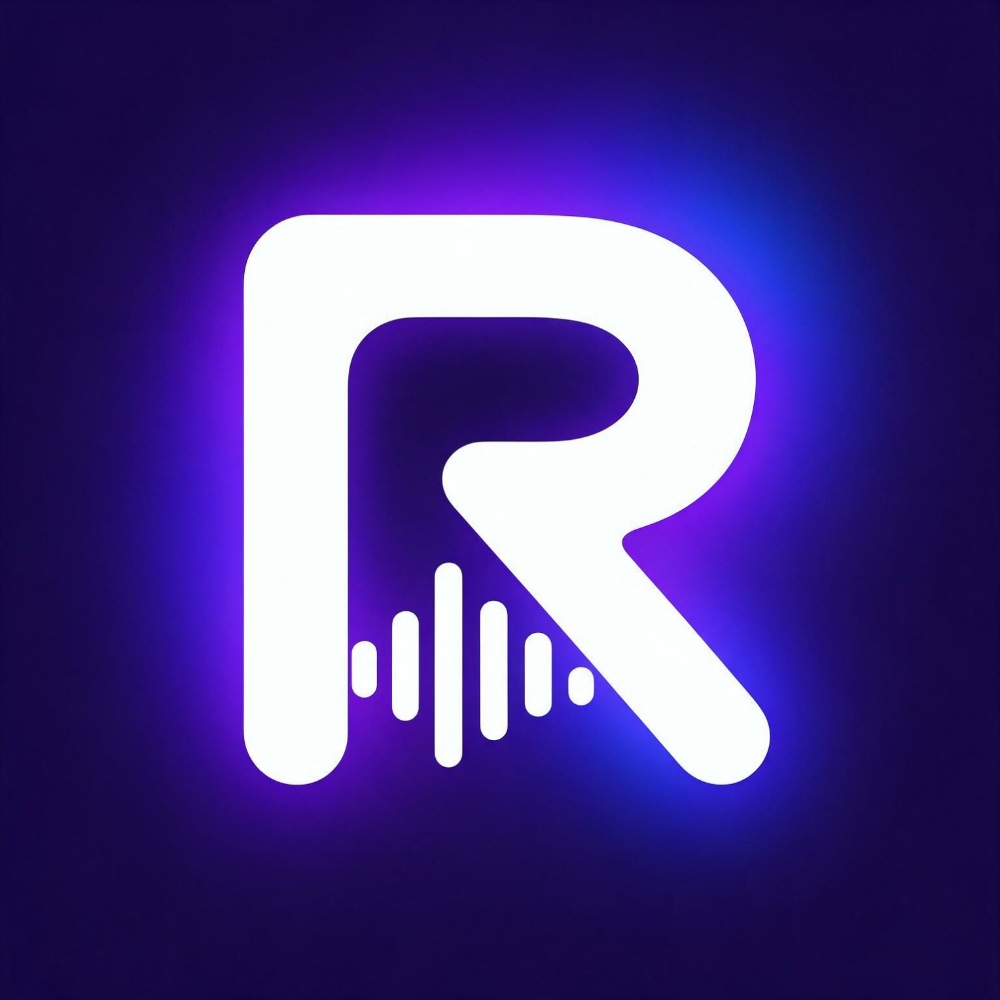

# 🎵 RuVibe — Next-Gen Music & Audio Streaming Platform

<p align="center">
  
</p>

<p align="center">
  <strong>A full-stack, high-fidelity music & audio streaming platform engineered for real-time playback, live chart streaming, verified artist publishing, and intelligent listener curation.</strong>
</p>

<p align="center">
  
  
  
  
  
  
</p>

---

## 🌟 Highlights & Architecture

- **⚡ Real-Time Streaming Audio Engine:** Built on HTML5 Audio with click-to-seek, volume control, playback rate stepping (0.75x–2x), repeat, shuffle, and persistent playback resume across reloads.
- **📈 Live Top Charts & Fallback Pipeline:** Dual-layer pipeline streaming live chart metadata from JioSaavn and iTunes APIs, combined seamlessly with community tracks.
- **🎙️ Verified Artist Studio:** Artists can upload audio tracks directly to cloud storage (ImageKit) and access their private catalog under **"My Uploaded Songs"** (filtered strictly from MongoDB).
- **✨ Intelligent Listener Curation:** Listeners get one-click mood curation (*Chill Hits*, *Acoustic Vibes*, *Trending Today*) directly through an animated profile pill dropdown.
- **📀 Studio Albums & Artist Profiles:** Full studio album tracklists and verified artist profiles with paginated discographies.
- **📻 Live Radio & Real Podcasts:** Built-in worldwide radio streaming and searchable podcast episodes.
- **📝 Live Synchronized Lyrics:** Pulls track lyrics in real-time or provides fallback lyric cards.
- **🌙 Sleep Timer & Full-Screen Ambient Mode:** Timed auto-pause countdown and immersive full-screen karaoke player.
- **🔒 Production Security Posture:** Strict HTTP-only cookies, dual rate limiting, Helmet security headers, ReDoS prevention, and Multer MIME allowlists.

---

## 🛠️ Tech Stack

### **Frontend**
- **Framework:** React 19 (Vite 8)
- **Styling:** Tailwind CSS 4 (Glassmorphism & animated glowing UI)
- **Icons:** Lucide React
- **State Management:** Zustand 5 (Persistent player store, toast store, favorites store, auth store)
- **HTTP Client:** Axios (Centralized instance with credentials and 401 interceptor)

### **Backend**
- **Runtime:** Node.js (Express 5)
- **Database:** MongoDB with Mongoose 9 ODM
- **Authentication:** JSON Web Tokens (JWT) stored in secure, `httpOnly`, `sameSite` cookies (with `Authorization: Bearer` fallback)
- **Password Hashing:** bcryptjs (Cost factor 10)
- **Cloud Storage:** ImageKit Node.js SDK
- **Security:** Helmet (CORP cross-origin configured), `express-rate-limit`, cookie-parser
- **Encryption:** CryptoJS DES decryption for streaming media URLs

---

## 📁 Project Structure

```text
ruvibe/
├── backend/
│   ├── src/
│   │   ├── controllers/
│   │   │   ├── auth.controller.js       # Register, login, me, and secure cookie clearing
│   │   │   ├── music.controller.js      # Charts, search, uploads, albums, lyrics, artist catalog
│   │   │   └── playlist.controller.js   # User playlist CRUD with ownership validation
│   │   ├── db/
│   │   │   └── db.js                    # MongoDB connection logic
│   │   ├── middlewares/
│   │   │   ├── asyncHandler.js          # Promise error wrapper
│   │   │   └── auth.middleware.js       # JWT cookie & Bearer token verification
│   │   ├── models/
│   │   │   ├── album.model.js           # Album schema
│   │   │   ├── music.model.js           # Music schema
│   │   │   ├── playlist.model.js        # Playlist schema
│   │   │   └── user.model.js            # User schema with roles ('user' | 'artist')
│   │   ├── routes/
│   │   │   ├── auth.routes.js           # Auth routes (/api/auth)
│   │   │   ├── music.routes.js          # Music routes (/api/music)
│   │   │   └── playlist.routes.js       # Playlist routes (/api/playlists)
│   │   ├── services/
│   │   │   ├── musicApi.service.js      # JioSaavn, iTunes, Radio & Lyrics API integrations
│   │   │   └── storage.service.js       # ImageKit media upload pipeline
│   │   ├── app.js                       # Express app configuration & middleware pipeline
│   │   └── server.js                    # Server bootstrap
│   ├── .env.examples                    # Backend environment template
│   └── package.json
│
├── frontend/
│   ├── src/
│   │   ├── api/
│   │   │   └── axios.js                 # Configured Axios instance with 401 interceptor
│   │   ├── components/
│   │   │   ├── AddToPlaylistModal.jsx   # Add track to user playlist modal
│   │   │   ├── AlbumsView.jsx           # Studio albums grid and tracklist drawer
│   │   │   ├── ArtistsView.jsx          # Artists directory and profile view
│   │   │   ├── AuthModal.jsx            # Sign in / Register modal
│   │   │   ├── FavoritesView.jsx        # Liked songs view
│   │   │   ├── FullScreenPlayer.jsx     # Ambient full-screen karaoke player
│   │   │   ├── HeroBanner.jsx           # Dynamic #1 featured release header
│   │   │   ├── Navbar.jsx               # Header with search, tabs, and profile dropdown
│   │   │   ├── PlaylistView.jsx         # Custom user playlist detail view
│   │   │   ├── PodcastView.jsx          # Real podcast streaming
│   │   │   ├── RadioView.jsx            # Live global radio stations
│   │   │   ├── RecentView.jsx           # Listening history view
│   │   │   ├── RightPlayer.jsx          # Docked player with lyrics & queue drawers
│   │   │   ├── Sidebar.jsx              # Navigation sidebar with playlist creation
│   │   │   ├── TopArtists.jsx           # Trending artists carousel
│   │   │   ├── TopCharts.jsx            # Live top chart tracks table
│   │   │   └── UploadModal.jsx          # Artist audio file upload modal
│   │   ├── store/
│   │   │   ├── useAuthStore.js          # User session store
│   │   │   ├── useFavoritesStore.js     # Liked songs store (optimistic UI)
│   │   │   ├── usePlayerStore.js        # Playback engine, queue, and sleep timer
│   │   │   └── useToastStore.js         # Animated notification toasts
│   │   ├── App.jsx                      # Main application view manager
│   │   └── main.jsx                     # Vite React entrypoint
│   ├── .env.example                     # Frontend environment template
│   ├── vite.config.js
│   └── package.json
│
└── README.md
```

---

## ⚙️ Environment Configuration

### **Backend (`backend/.env`)**
Create a `.env` file inside the `backend` folder:

```env
PORT=3000
NODE_ENV=development
FRONTEND_URL=http://localhost:5173

MONGO_URI=mongodb+srv://<username>:<password>@cluster.mongodb.net/ruvibe?retryWrites=true&w=majority
JWT_SECRET=your_super_secret_jwt_key_here

IMAGEKIT_PUBLIC_KEY=your_imagekit_public_key
IMAGEKIT_PRIVATE_KEY=your_imagekit_private_key
IMAGEKIT_URL_ENDPOINT=https://ik.imagekit.io/your_id

# Streaming APIs
JIOSAAVN_API_URL=https://www.jiosaavn.com/api.php
JIOSAAVN_DES_KEY=38346591
ITUNES_API_URL=https://itunes.apple.com/search
RADIO_BROWSER_API_URL=https://de1.api.radio-browser.info/json/stations/byname
LYRICS_API_URL=https://api.lyrics.ovh/v1
```

### **Frontend (`frontend/.env`)**
Create a `.env` file inside the `frontend` folder:

```env
VITE_API_BASE_URL=http://localhost:3000/api
```

---

## 🚀 Getting Started

### **1. Clone the Repository**
```bash
git clone https://github.com/your-username/ruvibe.git
cd ruvibe
```

### **2. Setup and Run the Backend**
```bash
cd backend
npm install
npm run dev
```
*The backend API server will start at `http://localhost:3000`.*

### **3. Setup and Run the Frontend**
In a new terminal window:
```bash
cd frontend
npm install
npm run dev
```
*The frontend development server will launch at `http://localhost:5173`.*

---

## ⌨️ Desktop Keyboard Shortcuts

RuVibe includes native desktop keyboard shortcuts:

| Key | Action |
|:---|:---|
| <kbd>Space</kbd> | Play / Pause current track |
| <kbd>→</kbd> | Skip to next track in queue |
| <kbd>←</kbd> | Skip to previous track in queue |
| <kbd>M</kbd> | Toggle Mute / Unmute |
| <kbd>L</kbd> | Like / Unlike currently playing song |
| <kbd>F</kbd> | Toggle Full-Screen Ambient Karaoke Player |

---

## 🛡️ Security Features

- **XSS-Resistant Cookies:** Auth tokens are stored in `httpOnly`, `secure`, and `sameSite` cookies to prevent JavaScript token theft.
- **Dual Rate Limiting:**
  - `authLimiter`: Strict 25 requests per 15-minute window on `/api/auth` to prevent brute-force attacks.
  - `apiLimiter`: 300 requests per 15-minute window on streaming and search endpoints.
- **ReDoS Prevention:** Search queries are sanitized via a regex escaper prior to MongoDB query construction.
- **Role-Based Access Control (RBAC):** Restricts music publishing and album creation strictly to authenticated users with `role: "artist"`.
- **Ownership Verification:** Scopes private playlist access strictly to `{ _id, user: req.user.id }`.
- **Upload Validation:** Capped at 25 MB with strict audio MIME filtering (`audio/mpeg`, `audio/wav`, `audio/ogg`, `audio/mp4`, `audio/aac`).

---

## 📄 License

This project is licensed under the [ISC License](LICENSE).
