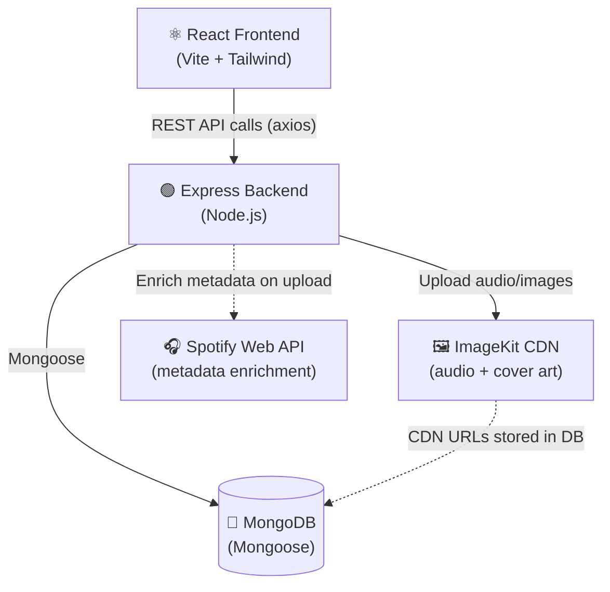
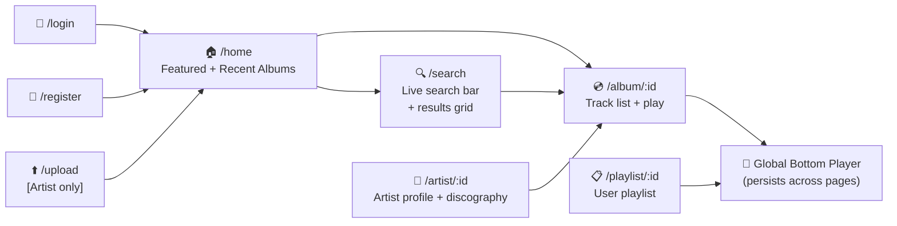
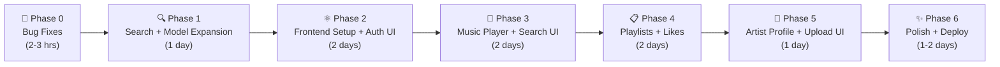

# 🎵 Spotify Clone — Full-Stack Development Plan

## 📦 Current Backend Audit (Honest State)

| File | What's done | Issues |
|---|---|---|
| `server.js` | Entry point, DB connect, listen | ✅ Clean |
| `src/app.js` | Express app, routes mounted | ✅ Clean |
| `src/db/db.js` | Mongoose connect | ✅ Clean |
| `user.model.js` | username, email, password, role | ❌ Missing avatar, bio, timestamps |
| `music.model.js` | uri, title, artist ref | ❌ Missing coverArt, genre, duration, likes, timestamps |
| `album.model.js` | title, musics[], artist ref | ❌ Missing coverArt, timestamps |
| `auth.controller.js` | register, login | ⚠️ register doesn't have JWT expiry. No try/catch |
| `music.controller.js` | upload, album, getAll, getAlbumById, logout | ❌ No search, no pagination, no try/catch, logout misplaced here |
| `auth.middleware.js` | authArtist, authUser | ✅ Correct logic |
| `storage.service.js` | ImageKit upload | ✅ Works, but no mime-type / file-size validation |
| `music.routes.js` | All routes wired | ⚠️ `upload.single("file")` on create-album (wrong), logout route is in music not auth |
| `auth.routes.js` | register, login | ❌ logout route missing here |

### 🐛 Bugs to Fix Before Anything New
1. **`registerUser` — no JWT expiry.** Add `{ expiresIn: "7d" }` (login already has it).
2. **No `try/catch` anywhere** in controllers — any DB failure = unhandled crash.
3. **`logout` is in `music.routes.js`** — it should be in `auth.routes.js`.
4. **`upload.single("file")` on `create-album`** route — albums don't upload audio.
5. **No input validation** — title, email, password are never validated.
6. **Unused imports** — `jwt`, `bcrypt` imported in `music.controller.js` but not used.

---

## 🗂️ Full-Stack Project Structure (Target)

```
spotify-clone/
├── backend/                        ← Move current code here
│   ├── src/
│   │   ├── controllers/
│   │   │   ├── auth.controller.js
│   │   │   ├── music.controller.js
│   │   │   ├── album.controller.js     ← NEW (split from music)
│   │   │   ├── playlist.controller.js  ← NEW
│   │   │   └── user.controller.js      ← NEW
│   │   ├── db/db.js
│   │   ├── middlewares/
│   │   │   ├── auth.middleware.js
│   │   │   ├── asyncHandler.js         ← NEW
│   │   │   └── validate.middleware.js  ← NEW (zod/joi)
│   │   ├── models/
│   │   │   ├── user.model.js
│   │   │   ├── music.model.js
│   │   │   ├── album.model.js
│   │   │   └── playlist.model.js       ← NEW
│   │   ├── routes/
│   │   │   ├── auth.routes.js
│   │   │   ├── music.routes.js
│   │   │   ├── album.routes.js         ← NEW
│   │   │   ├── playlist.routes.js      ← NEW
│   │   │   └── user.routes.js          ← NEW
│   │   ├── services/
│   │   │   ├── storage.service.js
│   │   │   └── spotify.service.js      ← NEW (metadata enrichment)
│   │   └── app.js
│   ├── .env
│   ├── package.json
│   └── server.js
│
└── frontend/                           ← NEW — React + Vite
    ├── public/
    ├── src/
    │   ├── api/                        ← Axios API layer
    │   │   ├── auth.api.js
    │   │   ├── music.api.js
    │   │   └── playlist.api.js
    │   ├── assets/
    │   ├── components/                 ← Reusable UI
    │   │   ├── Navbar.jsx
    │   │   ├── Sidebar.jsx
    │   │   ├── MusicCard.jsx
    │   │   ├── AlbumCard.jsx
    │   │   ├── AudioPlayer.jsx         ← Global bottom player
    │   │   ├── SearchBar.jsx
    │   │   └── ProtectedRoute.jsx
    │   ├── pages/
    │   │   ├── HomePage.jsx
    │   │   ├── LoginPage.jsx
    │   │   ├── RegisterPage.jsx
    │   │   ├── SearchPage.jsx          ← THE main goal
    │   │   ├── AlbumPage.jsx
    │   │   ├── PlaylistPage.jsx
    │   │   ├── ArtistPage.jsx
    │   │   └── UploadPage.jsx          ← Artist only
    │   ├── store/                      ← Zustand global state
    │   │   ├── authStore.js
    │   │   ├── playerStore.js          ← now playing, queue
    │   │   └── searchStore.js
    │   ├── hooks/
    │   │   └── useDebounce.js          ← for live search
    │   ├── App.jsx
    │   └── main.jsx
    ├── .env
    ├── index.html
    └── package.json
```

---

## 🔄 System Architecture



---

## 📋 All API Endpoints (Final Target)

### Auth  `/api/auth`
| Method | Route | Who | Description |
|---|---|---|---|
| POST | `/register` | Public | Register user or artist |
| POST | `/login` | Public | Login, set cookie |
| POST | `/logout` | Logged in | Clear cookie |
| GET | `/me` | Logged in | Get current user profile |

### Music  `/api/music`
| Method | Route | Who | Description |
|---|---|---|---|
| POST | `/upload` | Artist | Upload song + auto-enrich from Spotify API |
| GET | `/` | Logged in | Get all songs (paginated) |
| GET | `/search?q=&genre=` | Logged in | **Search songs by title / genre** |
| GET | `/:id` | Logged in | Single song detail |
| DELETE | `/:id` | Artist (owner) | Delete own song |
| POST | `/:id/like` | User | Toggle like on song |

### Albums  `/api/albums`
| Method | Route | Who | Description |
|---|---|---|---|
| POST | `/` | Artist | Create album |
| GET | `/` | Logged in | List albums (paginated) |
| GET | `/:id` | Logged in | Album detail with tracks |
| DELETE | `/:id` | Artist (owner) | Delete own album |

### Playlists  `/api/playlists`
| Method | Route | Who | Description |
|---|---|---|---|
| POST | `/` | User | Create playlist |
| GET | `/` | User | My playlists |
| GET | `/:id` | Logged in | Playlist detail |
| PATCH | `/:id/add` | Owner | Add song to playlist |
| PATCH | `/:id/remove/:musicId` | Owner | Remove song |
| DELETE | `/:id` | Owner | Delete playlist |

### Users  `/api/users`
| Method | Route | Who | Description |
|---|---|---|---|
| GET | `/:id` | Logged in | Public artist profile |
| PATCH | `/me` | Logged in | Update avatar/bio |
| GET | `/me/liked` | User | All liked songs |

---

## 🔍 Search — How It Works

### Step 1 — MongoDB Text Index (search your own songs)
```js
// music.model.js
musicSchema.index({ title: "text", genre: "text" });
```
```js
// music.controller.js — searchMusic
async function searchMusic(req, res) {
    const { q, genre, page = 1, limit = 20 } = req.query;
    const query = {};
    if (q) query.$text = { $search: q };
    if (genre) query.genre = genre;

    const musics = await musicModel
        .find(query)
        .populate("artist", "username avatar")
        .skip((page - 1) * limit)
        .limit(Number(limit));

    res.status(200).json({ musics, page, limit });
}
```

### Step 2 — Apple Music / iTunes Search API (Metadata & Global Search)
**100% Free, NO API Key needed, NO Premium account needed!**
Direct public endpoint: `https://itunes.apple.com/search?term=...&entity=song`

```
User/Artist searches or uploads "Blinding Lights"
        ↓
Backend calls iTunes API: https://itunes.apple.com/search?term=Blinding+Lights&entity=song&limit=1
        ↓
Gets back:
- High-res cover art (600x600)
- Genre (Pop, R&B, etc.)
- 30-second playable audio preview URL
- Track duration
- Artist and album name
        ↓
Saves enriched metadata to MongoDB!
```

```js
// src/services/spotify.service.js
const axios = require("axios");
let cachedToken = null, tokenExpiry = 0;

async function getToken() {
    if (cachedToken && Date.now() < tokenExpiry) return cachedToken;
    const res = await axios.post(
        "https://accounts.spotify.com/api/token",
        "grant_type=client_credentials",
        { headers: {
            "Content-Type": "application/x-www-form-urlencoded",
            Authorization: "Basic " + Buffer.from(
                process.env.SPOTIFY_CLIENT_ID + ":" + process.env.SPOTIFY_CLIENT_SECRET
            ).toString("base64"),
        }}
    );
    cachedToken = res.data.access_token;
    tokenExpiry = Date.now() + res.data.expires_in * 1000 - 60000;
    return cachedToken;
}

async function enrichTrack(title) {
    try {
        const token = await getToken();
        const res = await axios.get("https://api.spotify.com/v1/search", {
            headers: { Authorization: `Bearer ${token}` },
            params: { q: title, type: "track", limit: 1 },
        });
        const track = res.data.tracks.items[0];
        if (!track) return {};
        return {
            coverArt: track.album.images[0]?.url ?? null,
            genre: track.album.album_type,
            previewUrl: track.preview_url,
            popularity: track.popularity,
            duration: Math.round(track.duration_ms / 1000),
        };
    } catch { return {}; }   // never block an upload if Spotify is down
}

module.exports = { enrichTrack };
```

---

## 🎨 Frontend — Page by Page

### Pages & What Each Does



### Global Audio Player (Zustand store)
```js
// store/playerStore.js
import { create } from "zustand";

const usePlayerStore = create((set) => ({
    currentTrack: null,
    queue: [],
    isPlaying: false,
    play: (track) => set({ currentTrack: track, isPlaying: true }),
    pause: () => set({ isPlaying: false }),
    next: () => set((s) => ({
        currentTrack: s.queue[0] ?? null,
        queue: s.queue.slice(1),
    })),
    setQueue: (tracks) => set({ queue: tracks }),
}));
```

### Search Page — Live Search with Debounce
```jsx
// hooks/useDebounce.js
import { useState, useEffect } from "react";
export function useDebounce(value, delay = 400) {
    const [debounced, setDebounced] = useState(value);
    useEffect(() => {
        const t = setTimeout(() => setDebounced(value), delay);
        return () => clearTimeout(t);
    }, [value, delay]);
    return debounced;
}

// pages/SearchPage.jsx (concept)
const [query, setQuery] = useState("");
const debouncedQuery = useDebounce(query, 400);

useEffect(() => {
    if (debouncedQuery) fetchSearch(debouncedQuery); // hits GET /api/music/search?q=...
}, [debouncedQuery]);
```

---

## 🛣️ Phase-by-Phase Roadmap



### Phase 0 — Fix Bugs Now (2–3 hrs)
- [ ] Add `try/catch` to all controllers
- [ ] Add `asyncHandler` middleware wrapper
- [ ] Add global error handler in `app.js`
- [ ] Move `logout` route to `auth.routes.js`
- [ ] Remove `upload.single` from `create-album` route
- [ ] Add `{ expiresIn: "7d" }` to `registerUser` token
- [ ] Remove unused `jwt`, `bcrypt` from `music.controller.js`

### Phase 1 — Search + Model Expansion (1 day)
- [ ] Expand `music.model.js` (coverArt, genre, duration, likes[], timestamps)
- [ ] Expand `album.model.js` (coverArt, timestamps)
- [ ] Expand `user.model.js` (avatar, bio, timestamps)
- [ ] Add `playlist.model.js`
- [ ] Add MongoDB text index on music (title + genre)
- [ ] `GET /api/music/search?q=&genre=&page=` endpoint
- [ ] Install `axios`, create `spotify.service.js`
- [ ] Enrich track metadata on upload
- [ ] Like / unlike endpoint
- [ ] Playlist CRUD endpoints
- [ ] User profile endpoints
- [ ] Split album into its own controller + routes

### Phase 2 — Frontend Setup + Auth UI (2 days)
- [ ] `cd frontend && npm create vite@latest . -- --template react`
- [ ] Install: `tailwindcss`, `axios`, `zustand`, `react-router-dom`
- [ ] Setup Tailwind (dark theme — Spotify is dark!)
- [ ] Build `LoginPage`, `RegisterPage`
- [ ] Build `authStore` (Zustand) — persist user in localStorage
- [ ] Build `ProtectedRoute` component
- [ ] Build `Sidebar` + `Navbar` layout shell

### Phase 3 — Music Player + Search UI (2 days)
- [ ] Build `AudioPlayer` component (bottom bar)
- [ ] Build `playerStore` (Zustand)
- [ ] Build `HomePage` — featured albums grid, recent tracks
- [ ] Build `SearchPage` — live debounced search + results
- [ ] Build `AlbumPage` — tracklist, play all, add to playlist
- [ ] Build `MusicCard` + `AlbumCard` components

### Phase 4 — Playlists + Likes (2 days)
- [ ] Build `PlaylistPage`
- [ ] Like button on `MusicCard`
- [ ] "Add to playlist" modal on `MusicCard`
- [ ] "Liked Songs" pseudo-playlist in sidebar

### Phase 5 — Artist Features + Upload UI (1 day)
- [ ] Build `UploadPage` (artist only, hidden from regular users)
- [ ] Build `ArtistPage` (public profile + discography)
- [ ] Protect upload routes in frontend with role check

### Phase 6 — Polish + Deploy (1–2 days)
- [ ] Add `CORS` config in backend for frontend origin
- [ ] Add `helmet`, `express-rate-limit` for security
- [ ] Loading skeletons on all data-fetching pages
- [ ] Error boundary in React
- [ ] Deploy backend → **Render** or **Railway** (free tier)
- [ ] Deploy frontend → **Vercel** or **Netlify** (free tier)

---

## 🔧 New `.env` (Backend)
```env
PORT=3000
MONGO_URI=your_mongodb_uri
JWT_SECRET=your_jwt_secret
IMAGEKIT_PRIVATE_KEY=your_imagekit_private_key
IMAGEKIT_PUBLIC_KEY=your_imagekit_public_key
SPOTIFY_CLIENT_ID=your_spotify_client_id
SPOTIFY_CLIENT_SECRET=your_spotify_client_secret
CLIENT_URL=http://localhost:5173
```

## 🎨 Frontend `.env`
```env
VITE_API_URL=http://localhost:3000
```

---

## 📦 Final Dependencies

### Backend (add to existing)
```bash
npm install axios cors helmet express-rate-limit
```

### Frontend (fresh install)
```bash
npm create vite@latest frontend -- --template react
cd frontend
npm install axios zustand react-router-dom
npm install -D tailwindcss @tailwindcss/vite
```

---

> **IMPORTANT:** Start with Phase 0. The existing backend is not safe to build on top of without try/catch. One DB hiccup will crash your whole server.

> **TIP:** For the search feature, you don't need every Spotify feature — just the Client Credentials flow. It's free, doesn't need user permission, and works great for fetching metadata like cover art and genre when a song is uploaded.

> **NOTE:** Keep backend and frontend as separate folders in the same repo (/backend and /frontend). This is the cleanest structure for a learning project and maps directly to how real companies deploy full-stack apps.

